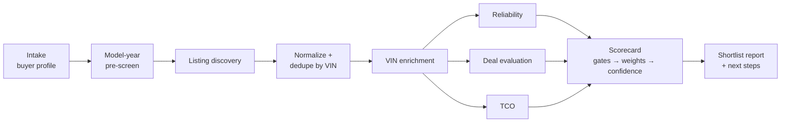

# Architecture

## Pipeline



1. **Intake.** Load `buyer-profile.yaml` and ask once, in a single batch, for anything material that's missing.
2. **Model-year pre-screen.** Before looking at any listings, rank candidate make/model/year ranges by reliability, safety and TCO. At a $10–15k target this matters most: it avoids spending listing-API calls on model years with known powertrain trouble.
3. **Discovery.** Query sources in priority order (below), capped per run.
4. **Normalize and dedupe.** Map every source into one `Listing` schema and merge duplicates by VIN. Keep every source URL and observation date.
5. **Enrichment.** Only the top N (default 25) after a cheap pre-score get VIN calls. Guided manual checks happen only for finalists.
6. **Scoring.** Apply [`scoring/scorecard.yaml`](../scoring/scorecard.yaml).
7. **Report.** Shortlist of the top 5 by default. Each car gets a per-criterion table, red flags, unknowns, citations and next steps.

## 1. Listing search across sources

### Source priority

| Tier | Mode | Sources | When |
|---|---|---|---|
| 1 | **API / MCP** | **CarGurus MCP** (official), **Dealer-Direct MCP** (~1M dealer-feed vehicles), auto.dev (free tier), OpenDealer (small index, strong deal analytics); MarketCheck or CarsXE (paid, opt-in) | Always first. Structured, licensed, cheap. Dedupe across them by VIN. |
| 2 | **Assisted browse** (Playwright MCP) | Franchise and independent **dealer sites** (schema.org `Vehicle`/`Car` JSON-LD), plus marketplaces whose robots.txt group for our UA token allows the path **and** whose ToS review in `config/sources.yaml` is `ok` | User-initiated, low volume |
| 3 | **Link-out** | CarGurus, Cars.com, Autotrader*, Edmunds, Carvana, TrueCar, CarMax, Craigslist, FB Marketplace, AutoTempest | Prefilled search URLs for the user to open. The user can paste listing URLs or VINs back in. |
| 4 | **User-provided** | Pasted listing text or URLs, VINs, screenshots, history-report PDFs | Always accepted |

\*Autotrader's robots.txt has a `Claude-User` group that allows search pages for user-initiated agent browsing, but its ToS still needs review before it moves to Tier 2.

### Policy engine (`src/policy/`), enforced in code, not just in prompts

| Control | Rule |
|---|---|
| **robots.txt gate** | Fetch and cache robots.txt for 24h. Evaluate against the configured UA token (default `Claude-User` for user-initiated work, falling back to the `*` group). A disallowed path aborts the fetch and records `blocked_by_robots`. If robots.txt itself is unreachable or challenged (4xx/5xx/challenge), treat the site as blocked. |
| **ToS registry** | `config/sources.yaml` → `tos_review: ok | restricted | prohibited | pending`. Only `ok` permits assisted browsing. |
| **Rate limits** | Per-domain token bucket. Default: 1 navigation every 12–20 s with jitter, ≤ 20 page loads per domain per session, ≤ 100 per day. Honor `Crawl-delay` when it's longer. Honor `Retry-After`. Back off exponentially on 429/503. |
| **Challenge detection** | CAPTCHA, Cloudflare "Just a moment", Akamai "Page unavailable", login walls, or a 403 → **stop that domain for the session**. Mark it `blocked` and hand the user a link-out. Never solve, never retry around it. |
| **No evasion** | No stealth plugins, UA spoofing, proxy rotation, residential IPs, fingerprint masking or CAPTCHA services. |
| **No auth** | Never log in on the user's behalf. Login-walled sources such as FB Marketplace are link-out only. |
| **Minimal capture** | Extract only vehicle fields. Strip private-seller names, phone numbers, emails and street addresses before storing. |
| **Caching** | 24h cache for search results and 7d for vehicle detail pages, to avoid re-fetching. |

### Normalized `Listing` (abridged)

```ts
interface Listing {
  vin?: string; year: number; make: string; model: string; trim?: string;
  price: number; priceIncludesFees?: boolean; mileage?: number;
  sellerType: "dealer" | "private" | "unknown"; dealerName?: string;
  location: { zip?: string; city?: string; state?: string; distanceMi?: number };
  titleStatusClaimed?: "clean" | "salvage" | "rebuilt" | "unknown";
  listedAt?: string; daysOnMarket?: number;
  priceHistory?: { date: string; price: number; source: string }[];
  freeHistoryReportUrl?: string;           // dealer-provided Carfax/AutoCheck link
  sources: { name: string; url: string; observedAt: string; accessMode: AccessMode }[];
  flags: string[];                         // e.g. "paid_placement", "finance_only_price"
}
```

## 2. VIN decode and vehicle history

| Step | Source | Mode | Output |
|---|---|---|---|
| Validate | ISO 3779 check digit (local) | code | invalid VIN → red flag (typo or a fake listing) |
| Decode | `@cardog/corgi` offline, cross-checked with vPIC `DecodeVinValues` | free API | year/make/model/trim/engine/drivetrain/plant |
| Claim check | listing vs decode | code | mismatch in year, trim or engine → red flag |
| Recalls (model year) | `api.nhtsa.gov/recalls/recallsByVehicle` + WhichTrim | free API/MCP | campaigns, `parkIt`, `parkOutSide`, OTA remedy |
| Open recalls (this VIN) | nhtsa.gov/recalls VIN lookup | **guided link-out** | user confirms remedied / open |
| Theft and total loss | NICB VINCheck | **guided link-out** (it has reCAPTCHA, and its terms forbid automation) | user records the result |
| Title brands, odometer | NMVTIS approved provider | **paid, optional** (~$3–10) | salvage/flood/junk/rebuilt brands, odometer readings |
| Accidents, service, owners | Free Carfax/AutoCheck link from the dealer listing; otherwise paid | link / paid | parsed by `history-report-review` from a user-supplied PDF |

**When paid reports are worth it**

| Situation | Recommendation |
|---|---|
| Every finalist (top 3–5) | **NMVTIS** (~$3–10). Cheapest authoritative check for title brands. |
| Final 1–2 cars, before paying for a PPI | **Carfax** if the dealer doesn't already provide it: best service-record and owner-count coverage. **AutoCheck** if the car has auction history, or to compare across many VINs (multi-report packs). |
| Private-party sale | Always buy a history report. There's no dealer-provided report, and fraud risk is higher. |
| Dealer listing with a free Carfax link | Use the free one and skip buying. |

Neither report replaces a PPI. Accidents never reported to insurers or police won't appear in any report.

## 3. Reliability (make/model/year)

| Signal | Source | Freshness | Notes |
|---|---|---|---|
| Complaint volume + severity | NHTSA complaints API | Daily updates; recent model years under-reported | Weight crash, fire, injury and death flags. Group by component: powertrain, engine and electrical weigh most. |
| Failure mileage | WhichTrim | Republisher; check its `as_of` date | "Problems cluster at 60–90k miles" matters when the listing shows 75k |
| Investigations (PE/EA) | NHTSA / WhichTrim | Ongoing | An open investigation is a yellow flag |
| TSBs / warranty extensions | WhichTrim (MY2016+) | Manufacturer-dependent | An extended warranty on a known failure softens the penalty if the car is still covered |
| Recall count + severity | NHTSA | Daily | `parkIt` / `parkOutSide` campaigns get heavy weight |
| Consumer Reports-style rating | **User-provided only.** CR is paywalled; never scrape it. | Annual | Optional input field, labeled with source and year |
| Owner forums / Reddit | Agent web search, graded | Varies | Grade A: repeated reports with specifics. Grade B: multiple vague reports. Grade C: a single anecdote. Only A and B affect the score; C is listed as context. |

Normalization: complaint counts scale with sales volume, which isn't free data. So the score compares each model year's complaints per year on the market against **its own segment peers** in the same pre-screen set. This keeps a high-volume Civic from being unfairly penalized. Every reliability score gets a `data_as_of` stamp. Model years under 3 years old are flagged `immature_data`.

## 4. Deal quality

1. **Comparables.** Same make/model, model year ±1, trim family, mileage ±20k, within radius (falling back to national). Dedupe by VIN. Drop outliers with the median absolute deviation (MAD > 3).
2. **Baseline.** Weighted median of comp prices (weight = similarity²), with a P25–P75 band. Needs at least 6 comps, otherwise `low_confidence`.
3. **Mileage adjustment.** Fit price against mileage (simple linear regression) within the comp set. If there are fewer than 10 comps, use a default of $0.08–$0.12 per mile, scaled by vehicle class (configurable).
4. **Fees.** Normalize prices that include fees vs. those that don't (Autotrader tiles include dealer fees). Exclude "finance-only" prices.
5. **Days on market and price drops.** Long time on market plus drops means negotiation leverage (a note, not a score penalty). A very fresh listing priced far below market should be verified before trusting it.
6. **Regional variance.** Compare the local median with the national median. If the local median is more than 8% above national, suggest a wider radius and factor in travel or shipping cost.
7. **Too good to be true.** More than 25% below baseline triggers a red flag (branded title, scam or data error) until the VIN checks pass.
8. **Dealer deals and incentives.** The deal score uses an *effective price*: fees normalized, bait rebates added back, qualifying incentives and financing-deal value subtracted. Aged inventory, outgoing model years and year-end timing are added as leverage notes. See [deals-and-incentives.md](deals-and-incentives.md).

## 5. Scorecard and shortlist

See [`scoring/scorecard.yaml`](../scoring/scorecard.yaml). Order of operations: **hard gates → criterion scores (0–100) → weighted sum → confidence → budget rule → rank**.

- **Shortlist:** top N (default 5) with `overall ≥ 65` and `confidence ≥ 0.6`. Stretch-budget cars ($15–35k) are included only if they clear the stricter "exceptional deal" bar.
- **Report per car:** score table (criterion, score, weight, evidence, source and date), red flags, unknowns, negotiation notes, and next steps (NMVTIS → seller questions → PPI → Carfax if still needed).

## MCP and tooling layout

See [`mcp-configs/mcp.example.json`](../mcp-configs/mcp.example.json). The TypeScript library in `src/` is the source of truth for policy and scoring. Skills call it through small CLI entry points (`npx car-research score …`) so the logic is deterministic and testable, not re-derived by the model on each run.
